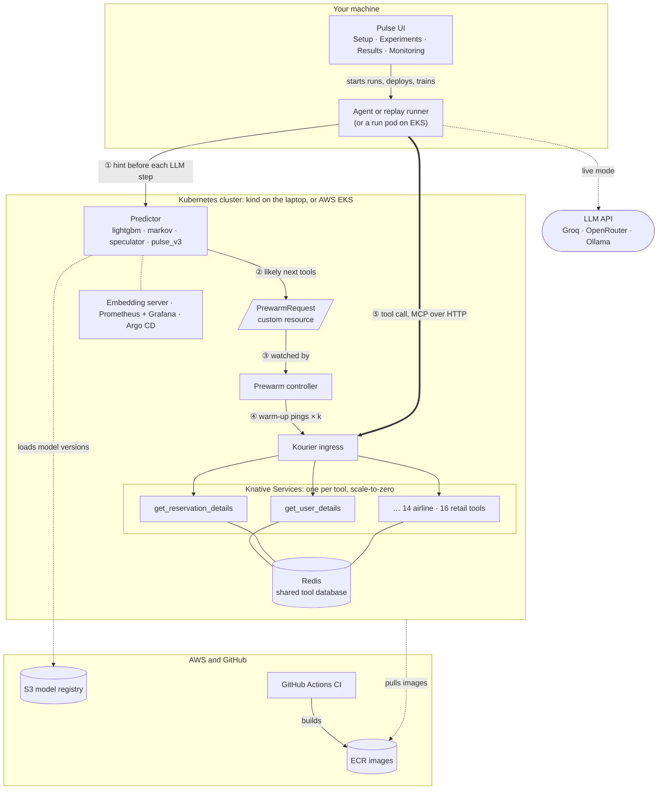

# Pulse: predictive prewarming of serverless tools for an LLM agent

An LLM agent calls tools (MCP servers) that run as serverless functions on Knative. A tool that has scaled to
zero needs a **cold start** (1–3 s) before it can answer; a warm tool answers in ~50–150 ms. Pulse predicts the
agent's next tool call **before the agent makes it** and starts that tool's pod in advance, so the call finds it
warm, without keeping every tool warm all the time.



**One step of an episode.** ① Before each LLM step the agent sends the predictor a hint: the tools called so far,
plus whatever that predictor reads (numeric signals, or the recent messages). ② The predictor ranks the next
actions and writes a `PrewarmRequest` for each likely tool. ③ The prewarm controller watches those objects and
④ sends each tool k warm-up pings through the ingress (k = the parallel calls expected), so Knative starts k pods.
⑤ The agent's real call finds a warm pod, or one already starting. Unused pods scale back to zero after Knative's
60 s idle window. On kind the UI runs the predictor and controller on your machine; on EKS they run in the
cluster. More in [DEV.md](DEV.md#1-architecture).

It is built on [tau-bench](https://github.com/sierra-research/tau-bench)'s airline customer-service tasks (14
tools; the retail domain's 16 tools can be replayed too), with a ReAct agent, an LLM-simulated customer, four
interchangeable predictors, a prewarm controller, experiment runners and a demo UI. It runs on a simulated cluster
(nothing to install), a local Knative cluster (kind), or AWS EKS. Everything is driven from the UI.

DS252 Cloud Computing, IISc. Developer documentation: [DEV.md](DEV.md).

---

## 1. Install

You need **Python 3.11+** and **Git** (on Windows, Git for Windows: its *Git Bash* runs the shell scripts).

```bash
git clone <this repository> pulse && cd pulse
bash scripts/setup.sh
```

`setup.sh` creates `.venv/`, installs `requirements.txt` and the `pulse` package, downloads tau-bench's public
recorded conversations into `data/tau-bench/`, and creates `.env` from `.env.example`.

Start the UI and open **http://127.0.0.1:8765**:

```bash
.venv/Scripts/python -m pulse.ui.server      # Windows (Git Bash)
.venv/bin/python -m pulse.ui.server          # Linux / macOS
```

The UI listens on this machine only (127.0.0.1): it can start runs, create clusters and spend money in your AWS
account, and has no login.

### What else, and when

| For | You need | Where in the UI |
|---|---|---|
| The demo on the simulated cluster | nothing more | Live demo |
| Live agent runs, the AI customer, the `speculator` predictor | an LLM: a Groq API key (free tier works), OpenRouter, or a local Ollama | Setup → LLM keys |
| The `pulse_v3` predictor | its model: train it here (~45 min, needs Docker for its embedding server) | Setup → This project |
| A real Knative cluster on this machine | Docker (≥ 4 GB), kind, kubectl | Setup → Local cluster |
| AWS EKS | an AWS account (CLI logged in, not the root user), eksctl or Terraform, kubectl, Docker | Setup → AWS EKS |
| Monitoring and GitOps | helm (and for GitOps a fork of this repository) | Setup, Monitoring tab |

Setup → *Tools on this machine* shows which of these are installed. On Windows, install them with `winget`
(`winget install Helm.Helm`, likewise `Kubernetes.kind`, `Kubernetes.kubectl`, `Amazon.AWSCLI`,
`Hashicorp.Terraform`) or, in Git Bash, with [arkade](https://github.com/alexellis/arkade) (`arkade get helm`; the
UI also finds tools in `~/.arkade/bin`). Restart the UI afterwards, so it sees the new PATH.

---

## 2. Use it from the UI

### Setup tab: get everything ready

| Card | Buttons |
|---|---|
| This project | Download data · Train lightgbm + markov (they ship trained; this reproduces them, ~1 min) · Train retail lightgbm + markov (~1 min) · Start / stop the embedding server · Train pulse-v3 |
| LLM keys and settings | Groq keys (*+ Add another key* for as many as you have: they are used in turn, which spreads Groq's per-minute limits), an OpenRouter key, the LLM backend, a local OpenAI-compatible server for the speculator. Saved to `.env`; values are never shown again |
| Local cluster (kind) | Create cluster (kind + Knative + Kourier + Redis + the 14 tools at scale-to-zero, ~5 min) · Deploy the retail tools (the 16 retail tools next to them, ~3 min) · Build image for kind · Delete cluster |
| AWS EKS | Region · Build + push image (to your ECR) · Create cluster (eksctl, or Terraform with the checkbox; ~20 min) · Delete cluster · Check for leftovers |
| Pulse in the current cluster | Deploy Pulse's services (predictor, prewarm controller, embedding server; also copies your LLM keys into the cluster as a Secret) · Switch predictor · Install Prometheus + Grafana |
| Cloud extras | 1. Terraform state bucket (once per AWS account) · 2. Terraform plan · 3. Terraform apply (S3 model registry, ECR, CI roles; it then fills in the model registry URIs) · Model registry (the two URIs: type them, or *Fill in from Terraform*; saved to `.env`, used at once) · Upload training data · Publish local model · GitOps: set my AWS account · Install Argo CD. Optional; more in [DEV.md §6](DEV.md#6-cicd-and-gitops) |

Every action runs as a job with its log in the same tab; actions that cost money or delete something ask first.
One job runs at a time.

### The top bar: where the tools run

- **Simulated cluster** (default): pods, cold starts and the 60 s idle window are simulated, with cold-start times
  measured on EKS (`data/coldstart/`). No cluster needed.
- **Knative**: the real tools on the current kubectl context (kind or EKS). The bar also shows monitoring and
  GitOps status, and the **domain**: *Airline* (14 tools, the default) or *Retail* (16 tools; deploy them first,
  Setup → Local cluster). With *Retail*, experiment runs replay tau-bench's recorded retail conversations
  (workload W3) and lightgbm / markov use the retail model (Setup → *Train retail lightgbm + markov*; it also
  picks the 23 held-out retail tasks the Experiments tab offers). Our live agent, the LLM speculator and in-cluster
  runs are airline only.

### Predictor card (right side)

Pick the predictor, the prewarm policy (θ threshold or top-k, optional lookahead) and θ. The card shows which
inputs the running predictor reads (trajectory / signals / history) and its answer latency.

| Predictor | Reads | What it is |
|---|---|---|
| `lightgbm` (main) | tool trajectory + numeric signals about the conversation | LightGBM next-action model, with fan-out and lookahead |
| `markov` | tool trajectory | order-2 Markov chain over actions |
| `speculator` | trajectory + the last 10 messages | an LLM guesses the next action (needs LLM keys or a local server) |
| `pulse_v3` | trajectory + the last 10 messages | conversation text, a tool graph and state flags, with an online adapter (needs its model) |

### Live demo

One episode at a time, on screen: the **live agent** with an AI or a human customer (needs LLM keys), a
**recorded** tau-bench episode replayed with real timing, or one of your own live runs replayed exactly. Run the
same task with prewarming **off (C0)** and **on (C3)** and compare end-to-end time, tool wait and cold calls. On
Knative, *Background load* adds more replayed agents on the same tools while the episode runs.

### Experiments

Batch runs that write a result folder to `results/`:

- **Mode**: *Replay* (recorded episodes, reproducible with a seed), *Live* (the agent with an LLM customer), or
  *Load test* (Locust or asyncio, against the predictor API, the tools, or whole episodes).
- **Configuration**: **C0** scale-to-zero, no prewarming · **C1** always warm (the latency floor) · **C3**
  scale-to-zero with a predictor (Pulse).
- **Runner**: this machine, or a pod inside the cluster (best on EKS: no laptop-to-cloud network in the timings).

### Results, Monitoring, Models

- **Results**: every run with its latency percentiles, cold share and pod-seconds; tick runs to compare them and
  make plots; download a run folder as a zip.
- **Monitoring**: Grafana's dashboards (predictor latency, prewarms, tool pods), and a link from any run to its
  time window. Needs *Install Prometheus + Grafana*.
- **Models**: the S3 model registry, for pulse-v3 and for lightgbm + markov: versions with their held-out
  metrics, **Use** a version, **Promote** / roll back, **Pin in Git** (GitOps), **Retrain** here or as a Kubernetes
  Job. A new version becomes *latest* only if it beats the current one on held-out tasks. Set up the registry
  in Setup → Cloud extras (steps 1–3; *Terraform apply* fills in its URIs).

---

## 3. Typical sessions

**Demo, nothing installed.** Live demo → *Replay recorded*, task 30 → run with prewarming off, then on → compare.

**Local Knative.** Setup → *Create cluster* (kind). Top bar → *Knative*. Experiments → Replay, C0, then C3 →
Results → compare and plot. Optional: Setup → *Install Prometheus + Grafana*, then the Monitoring tab.

**Retail on kind.** Setup → *Train retail lightgbm + markov*, *Deploy the retail tools* → top bar *Knative*,
*Retail* → Experiments → Replay, held-out retail tasks, C0 then C3 → Results.

**AWS EKS.** Setup → AWS EKS: *Build + push image*, *Create cluster* (confirms the cost) → Pulse in the current
cluster: *Deploy Pulse's services* → top bar *Knative* → Experiments with Runner = *Run pod* → Results.
**At the end of every session**: Setup → *Delete cluster*, then *Check for leftovers*. ECR images and the S3
registry stay; they cost cents a month.

**pulse-v3.** Setup → *Start embedding server* (Docker) → *Train pulse-v3* (~45 min) → Predictor card → `pulse_v3`.
The runner image then carries the model, so it also works on EKS without the S3 registry.

---

## 4. Costs and safety

- The simulated cluster and kind are free.
- An EKS session costs roughly **$1–3 per hour** (control plane ~$0.10/h plus three `m7i-flex.large` nodes and a
  load balancer). New AWS accounts may need a vCPU quota of at least 6 for these instances.
- The tools' load balancer on EKS only accepts your own IP address.
- `.env` (LLM keys) is gitignored and never leaves this machine except as a Kubernetes Secret in your own cluster.

---

## 5. Without the UI

Everything the UI does is a command; the UI only runs them. The main ones (from the repository root, with the
virtual environment's Python):

```bash
python -m pulse.setup.download_data                     # data/tau-bench/
python -m pulse.setup.train_models action|action_retail|pulse_v3|all   # models/
bash scripts/embed_server.sh [stop]                      # pulse_v3's embedding server (Docker)
PREDICTOR=lightgbm python -m uvicorn pulse.predictor.service:app --port 8000
python -m pulse.controller.prewarm_controller
python -m pulse.experiments.replay --fanout --predictor-url http://127.0.0.1:8000
bash infra/kind/setup.sh && SKIP_BUILD=1 bash infra/knative/deploy.sh 0
DOMAIN=retail python -m pulse.experiments.replay --fanout   # retail (MCP_HOST_TEMPLATE=retail-{svc}.default.example.com)
bash infra/eks/eks_up.sh        |  bash infra/eks/eks_down.sh
bash infra/monitoring/install.sh                          # Prometheus + Grafana in the current cluster
bash infra/cloud/build_image.sh |  bash infra/cloud/cloud_up.sh  |  CONFIG=C3 bash infra/cloud/run_cloud.sh --fanout
```

Each module and script explains its options at the top of the file. [DEV.md](DEV.md) describes the parts.

---

## 6. Troubleshooting

| Symptom | Fix |
|---|---|
| A Setup button says *bash not found* | Install Git for Windows (Git Bash), or run the UI on Linux / macOS |
| Predictor card stays *loading…* | LightGBM takes up to a minute to import; if it turns *exited*, its last log lines are on the card |
| *No Groq key* when starting a live run or the speculator | Setup → LLM keys, then restart the predictor |
| `pulse_v3` will not start | Train its model (Setup → This project), or set the model registry (Setup → Cloud extras) |
| Knative mode shows no tools | Create the cluster (Setup), or check `kubectl config current-context` |
| EKS: *ImagePullBackOff* | Build + push the image first (Setup → AWS EKS, step 1) |

---

## Credits

tau-bench's airline and retail tools, tasks and recorded conversations are © Sierra, MIT license
(`pulse/agent/tau_airline/LICENSE`, `pulse/agent/tau_retail/LICENSE`). The airline tools' image defaults to a
published copy on Docker Hub; the retail tools' image is built on your machine (Setup → *Deploy the retail tools*).
