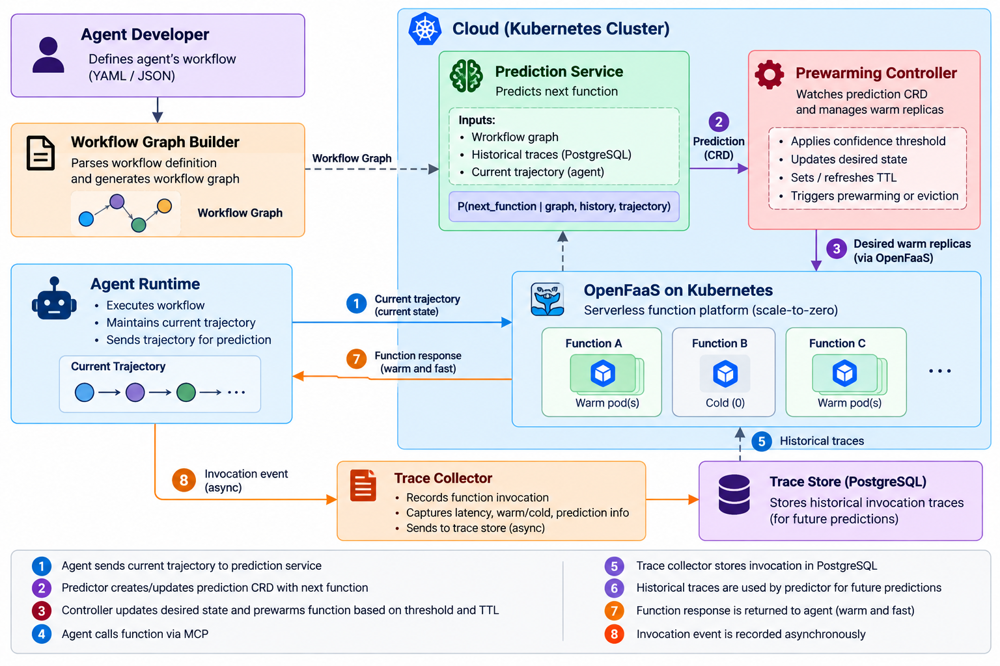
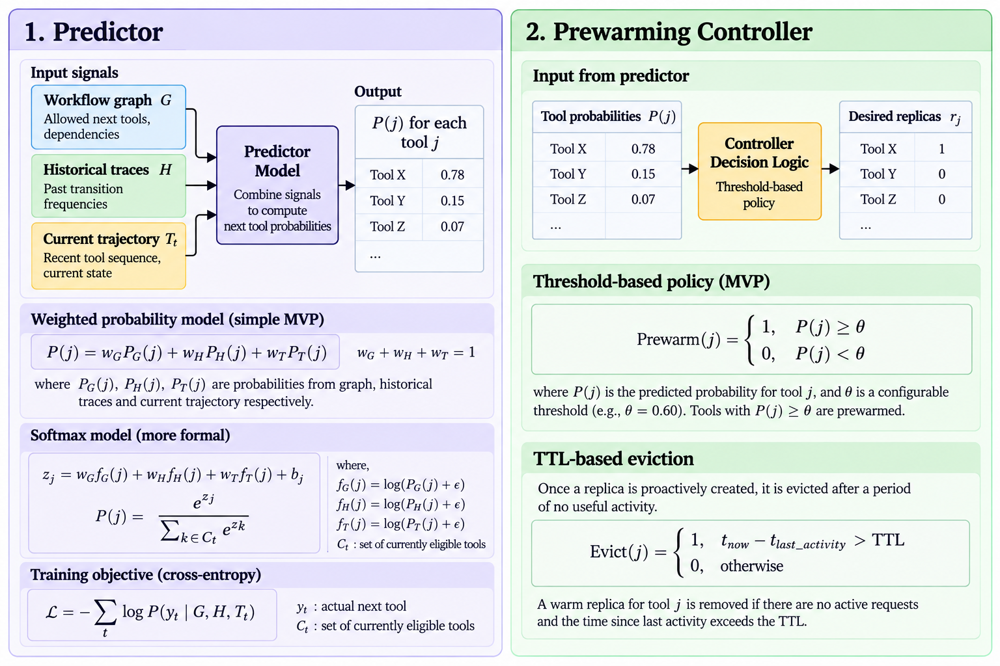

Project Requirements Document (PRD)

**Kubernetes/MCP Predictive Prewarming for Agentic Workflows on OpenFaaS**

| **Field**    | **Details**                                                                                                                                                                                                                                                                    |
| ------------ | ------------------------------------------------------------------------------------------------------------------------------------------------------------------------------------------------------------------------------------------------------------------------------ |
| Course       | DS252: Introduction to Cloud Computing (Aug 2026)                                                                                                                                                                                                                              |
| Team Name    | Pulse                                                                                                                                                                                                                                                                          |
| Team Members | \[[ajinkyagawa1@iisc.ac.in](mailto:ajinkyagawa1@iisc.ac.in) - 28674\] ;\[[aniruthal@iisc.ac.in](mailto:aniruthal@iisc.ac.in) - 29079\]; \[[nithishyh@iisc.ac.in](mailto:nithishyh@iisc.ac.in) -27928\]; \[[patelsamitk1@iisc.ac.in](mailto:patelsamitk1@iisc.ac.in) - 29260\]; |
| Summary      | Predict the next MCP tool in an agent workflow and prewarm its OpenFaaS pod, reducing cold-start latency while controlling idle resource cost.                                                                                                                                 |
| Date         | 17 September 2026                                                                                                                                                                                                                                                              |

# 1. Problem statement and motivation

Autonomous agentic workflows (e.g., ReAct, Plan-and-Solve) increasingly rely on the Model Context Protocol (MCP) to interact with external tools. These MCP tools are typically hosted as lightweight microservices on serverless platforms like OpenFaaS on Kubernetes to leverage automatic scaling and cost-effective scale-to-zero capabilities. However, a critical execution mismatch arises: MCP tool calls are often short (50–150 ms), whereas OpenFaaS scale-to-zero cold starts take 1–3 seconds due to pod creation and readiness checks. In multi-step sequential reasoning loops, this cold-start delay accumulates, creating severe end-to-end tail latency for users.

Standard reactive autoscalers only respond after an HTTP request hits the gateway, making cold starts inevitable. Conversely, keeping all tool replicas permanently warm eliminates cold starts but causes unsustainable resource inflation. While static function chaining works for fixed workflows, AI agents select tools dynamically and non-deterministically based on context.

This project solves this dilemma by using forward-looking execution signals, such as workflow graph transitions, execution history, and prompt trajectories emitted by the agent before tool execution. A prediction service ranks candidate tools and passes high-confidence targets (θ) to a Kubernetes Custom Resource Definition (CRD) controller. The controller proactively scales up the required OpenFaaS pod with a short Time-To-Live (TTL), automatically evicting it if unused.

In real-world applications such as customer support bots calling CRM/ticketing APIs or research agents orchestrating multi-step web searches, this system delivers near-always-warm execution latency (>20% reduction in p50, >15% in p99) while saving >30% in idle resource costs compared to static provisioned concurrency. Evaluating this requires actual cloud infrastructure to capture true Kubernetes scheduling, control-plane reconciliation, and scale-to-zero dynamics.

# 2. Scope: in-scope, out-of-scope, assumptions

## 2.1 In scope

- Kubernetes + OpenFaaS deployment with 4–8 lightweight MCP tool functions.
- Agent context interface carrying workflow identity, active execution node, and recent trajectory.
- Prediction microservice evaluating workflow graph topology, historical telemetry, and real-time signals.
- Kubernetes prewarming controller/CRD with confidence threshold and TTL eviction.
- Prometheus instrumentation and reproducible workload/trace generation.
- Comparison of scale-to-zero, always-warm, static-frequency warm and predictive configurations.

## 2.2 Out of scope

- LLM training/fine-tuning prediction concerns tool choice only.
- Cross-region federation, production disaster recovery and commercial autoscaler features.
- Optimization of individual tool business logic beyond controlled startup behavior.
- Permanent replacement of OpenFaaS autoscaling.

## 2.3 Assumptions

- MCP tool IDs are stable, unique, and map 1:1 to registered OpenFaaS function endpoints.
- Agent developer provides with the workflow definition for every unique workflow id
- The agent runtime emits prediction hints early enough during LLM planning for prewarming to complete before tool invocation.
- Container image versions are pinned, and node image-cache states are explicitly tracked to isolate control-plane latency.
- The Kubernetes cluster has adequate CPU/memory headroom so scheduling reflects true control-plane reconciliation rather than resource starvation.
- Trace store tables record structural, timing, and resource metrics while completely scrubbing raw prompts and credentials.

# 3. Stakeholders and usage scenarios

| **Stakeholder** | **Role / need**                                  |
| --------------- | ------------------------------------------------ |
| Agent developer | Workflow, Agent hints and consumes tool results. |
| Cloud operator  | Runs Kubernetes/OpenFaaS and controls resources. |
| End user        | Experiences workflow latency.                    |

## 3.1 Usage scenarios

Across multi-step agentic workflows such as order tracking, CRM lookup, research, document processing, and refunds, the system predicts likely next MCP tool calls and proactively prewarms the required OpenFaaS functions while the agent is reasoning. This reduces accumulated cold-start latency and improves response time without keeping all tools permanently active.

General Agentic Workflows: For workflows involving multiple tools and dynamic decisions, the system prepares high-confidence tools in advance and automatically removes unused warm instances using TTL. When predictions are uncertain or incorrect, the workflow falls back to normal reactive execution, maintaining reliability while balancing latency and resource usage.

**4\. Functional requirements**

| **ID** | **Pri.** | **Capability**                                                                                  | **Acceptance**                                                                |
| ------ | -------- | ----------------------------------------------------------------------------------------------- | ----------------------------------------------------------------------------- |
| FR-1   | Must     | Register MCP tools with stable IDs, OpenFaaS mapping and resource/startup metadata.             | Registry returns one valid record per tool; duplicates are rejected.          |
| FR-2   | Must     | Agent emits current workflow node and recent trajectory before tool calls.                      | 100/100 test calls produce valid hints.                                       |
| FR-3   | Must     | Represent each supported workflow as an allowed-transition graph.                               | Replay traces map without unknown-node errors.                                |
| FR-4   | Must     | Return ranked next-tool probabilities from graph, history and trajectory features.              | Probabilities are returned and sum to 1.0 ±0.01.                              |
| FR-5   | Must     | Apply configurable(through experimental analysis) confidence threshold θ to prewarm candidates. | Below-threshold tools are absent from the desired warm set.                   |
| FR-6   | Must     | Reconcile desired warm replicas with Kubernetes/OpenFaaS state.                                 | Eligible hint causes a target replica to become ready without manual action.  |
| FR-7   | Must     | Attach TTL to proactive replicas and evict after expiry.                                        | TTL can be configured based on experimental analysis                          |
| FR-8   | Must     | Fall back to normal invocation for late/missed predictions.                                     | 100/100 deliberate misses still return correct results.                       |
| FR-9   | Must     | Record timestamps for request, readiness and response.                                          | Completed calls have all required timestamps or explicit missing-stage codes. |
| FR-10  | Must     | Run baselines/treatments from one workload definition and seed.                                 | Repeated seeded runs use identical request ordering.                          |
| FR-11  | Should   | Expose Prometheus metrics for latency, prediction and warm-pool size.                           | All required series appear during a run.                                      |
| FR-12  | Should   | Log prewarm/retain/evict decisions                                                              | Audit record contains tool, probability, action, TTL, time only.              |

# 5. Non-functional requirements

Reference workload: 4–8 tools, 50–150 ms tool execution, 20 concurrent clients, 10-minute steady state, 3 repeated trials. Images are cached unless an experiment studies image pulls.

| **ID** | **Class**    | **Target**                                                                     | **Measurement**                              | **Exp.** |
| ------ | ------------ | ------------------------------------------------------------------------------ | -------------------------------------------- | -------- |
| NFR-1  | Latency      | Predictive p50 is atleast 20% lower than scale-to-zero p50.                    | Client latency histogram; 3 trials.          | E1/E2    |
| NFR-2  | Latency      | Predictive p99 is atleast 15% lower than scale-to-zero p99.                    | Same trace seed and client-side timing.      | E1/E2    |
| NFR-3  | Throughput   | Greater than 20 concurrent clients for 10 min with ≥99% successful tool calls. | Locust/asyncio + success counter.            | E3       |
| NFR-4  | Decision     | Prediction API p95 less than 50 ms at 10 hints/s.                              | Monotonic client timing.                     | E4       |
| NFR-5  | Scale        | Manage ≥20 tools and 4 warm replicas without missed reconciliations.           | Controller events + desired/actual replicas. | E5       |
| NFR-6  | Availability | ≥99% successful prediction/control operations in 30 min.                       | API/controller counters.                     | E3/E6    |
| NFR-7  | Resource     | ≥30% fewer warm-Pod-seconds than always-warm while meeting NFR-1/2.            | Kubernetes residence-time metrics.           | E2/E7    |
| NFR-8  | Eviction     | ≥95% expired Pods removed within TTL+10 s.                                     | Expiry vs observed scale-down.               | E5       |
| NFR-9  | Security     | Zero client secrets stored in trace storage                                    | Schema check + automated scan.               | E6       |
| NFR-10 | Cost         | Latency saved per idle Pod-second.                                             | Apply Sec. 7 model.                          | E7       |

# 6. System architecture and technology stack

The design separates prediction from control. The agent emits a small hint; the predictor ranks candidate tools and save it in the form of a CRD, the Prewarming controller updates the desired state and the Kubernetes controller reconciles warm state; OpenFaaS serves the function.

_Figure 1. System Architecture_

**6.1 Tier boundaries**

| **Boundary**                    | **Data**                                               | **Purpose**                                  |
| ------------------------------- | ------------------------------------------------------ | -------------------------------------------- |
| Device → Cloud                  | Workflow ID, Current tool, Trajectory, Graph ID, Time  | Prediction Request.                          |
| Cloud \[Predictor→ Controller\] | Tool ID, Probability, Threshold, TTL, Desired replicas | Prediction output and desired prewarm state. |
| Cloud → Device                  | Tool result and latency                                | Workflow execution response + measurement.   |
| Cloud → Trace store             | Tool/timing/resource/prediction fields                 | Replay and evaluation.                       |

## 6.2 Technology stack

| **Layer**     | **Choice**                     | **Reason**                                         |
| ------------- | ------------------------------ | -------------------------------------------------- |
| Orchestration | Kubernetes                     | Multi-Pod scheduling and reconciliation.           |
| FaaS          | OpenFaaS\*                     | Independent functions and scale-to-zero behavior.  |
| MCP           | MCP SDK with small servers     | Repeatable tool endpoints with controlled startup. |
| Prediction    | Python + scikit-learn baseline | Fast, interpretable prototype.                     |
| Controller    | Go + controller-runtime        | Native reconciliation model.                       |
| Load/metrics  | Locust, Asyncio + Prometheus   | Repeatable load and telemetry.                     |
| Trace store   | SQLite/PostgreSQL              | Keeps application history outside API server.      |

In OpenFaas scale to zero is available only in pro version which is paid.

## 6.3 Predictor and Prewarming-Controller

## 6.4 Design decisions

**Controller + CRD over Script:** A Kubernetes controller with a CRD continuously reconciles desired vs. actual warm replicas, recovering automatically from pod failures; a one-off script cannot reliably maintain warm state.

**Feature Models over Deep Models:** A lightweight weighted model is used first for interpretability and easy debugging; LSTMs/Transformers are deferred until prewarming's impact can be measured independent of model complexity.

**Go over Python:** Go is native to Kubernetes, with mature controller libraries (client-go, controller-runtime) and lower runtime overhead than Python for this use case.

**MCP over Direct API Calls:** MCP gives standardized, discoverable tools with controllable startup behavior; direct API calls bypass this abstraction and limit our ability to evaluate prewarming.

# 7. Evaluation plan

## 7.1 Hardware Requirement

Device Tier (Client) – outside the cluster – (2-4 vCPU, 8 GB) - We can use our laptop for load generation and agent calling.

Cloud Tier - Kubernetes cluster - 2 worker nodes (2-4 vCPU, 16 GB, 50 GB SSD each).

## 7.2 Comparison configurations

| **Cfg.** | **Definition**                                             | **Purpose**                                   |
| -------- | ---------------------------------------------------------- | --------------------------------------------- |
| C0       | scale-to-zero; no proactive warm pool.                     | Reactive cold-start baseline.                 |
| C1       | One ready replica per tool.                                | Warm latency floor / resource upper baseline. |
| C3       | Graph + history + trajectory predictor with threshold/TTL. | Proposed method.                              |

## 7.4 Workload, agent and MCP tools

**Agent.** A custom **ReAct-style agent** (reason → act → observe, one tool call at a time). , ReAct decides its next tool only after seeing the previous result, so the next tool is genuinely uncertain at runtime — this is what our predictor needs to be useful. Each step emits a hint (current state + recent trajectory) to the Prediction Module before the tool call is made.

**Tools.** 14 tools from tau-bench's airline environment \[9\], covering reads. and 7 writes gated by user confirmation per tau-bench policy.

**Workloads.** Three tasks similar to the example stated in 3.1, each requiring 6–9 tool calls with at least one runtime branch (a decision only resolvable from a tool's result), so the predictor must disambiguate rather than follow a fixed chain.

## 7.3 Metrics

## Table 1: Experiments

| **ID** | **Experiment**              | **Configs**    | **What varies**            |
| ------ | --------------------------- | -------------- | -------------------------- |
| E1     | Cold-start characterization | C0, C1         | — (fixed load)             |
| E2     | Main latency benchmark      | C0, C1, C2, C3 | — (fixed θ, TTL)           |
| E3     | Prediction API load test    | C3             | Hint rate: 1/5/10/20 per s |
| E4     | Resource usage              | C0, C1, C2, C3 | — (same runs as E2)        |
| E5     | Concurrency ramp            | C0, C1, C3     | Clients: 5/10/20           |
| E6     | Threshold sweep             | C3             | θ: 0.3/0.5/0.7/0.9         |
| E7     | TTL sweep                   | C3             | TTL: 30/60/120 s           |

**Protocol (all experiments):** 3 branching tau-bench workflows (§7.4), fixed seeds, 2-min warm-up + 10-min steady state, 3 trials (median, min/max reported). E6 and E7 vary one parameter at a time, holding the other at its default.

## Table 2: Metrics

| **#** | **Metric & plot**                                                                                                                                                       | **Hypothesis**                                                                                                                       | **Exp**             |
| ----- | ----------------------------------------------------------------------------------------------------------------------------------------------------------------------- | ------------------------------------------------------------------------------------------------------------------------------------ | ------------------- |
| 1     | **Tool-call latency.** Bar plot: p50/p95/p99 per configuration. Startup breakdown: scheduling, image pull (if any), readiness, init.                                    | C1 is the lower bound, C0 the upper bound; C3 cuts p50/p99 well below C0 and sits close to C1.                                       | E1, E2              |
| 2     | **Prediction API latency.** Line plot: p50/p95/p99 vs hint rate.                                                                                                        | Latency rises with hint rate; p95 stays within target (≤50 ms) at the expected rate.                                                 | E3                  |
| 3     | **Resources.** Line plot: warm pods vs time. Bar plot: total vs idle pod-seconds per configuration.                                                                     | C3 uses fewer warm pod-seconds than C1 while still meeting the latency targets from Metric 1.                                        | E4                  |
| 4     | **Scalability.** Line plot: p99 vs number of clients.                                                                                                                   | p99 grows gradually with clients (no cliff) for C3.                                                                                  | E5                  |
| 5     | **Threshold sensitivity.** Line plot: warm-hit rate, false-positive rate and idle pod-seconds vs θ.                                                                     | Higher θ lowers false positives and idle pods but also warm-hit rate; a knee exists where most latency benefit is kept at low waste. | E6                  |
| 6     | **TTL sensitivity.** Line plot: warm-hit rate and idle pod-seconds vs TTL.                                                                                              | Very short TTL evicts prewarmed pods before use (low hit rate); very long TTL wastes idle time; a middle TTL balances both.          | E7                  |
| 7     | **Efficiency.** Bar plot: E per configuration, where  E = N·(mean L_C0 − mean L_cfg) / P_idle (N = completed calls, L = mean latency, P_idle = idle pod-seconds). | C3 is the most efficient configuration (highest latency saved per idle pod-second).                                                  | derived from E2, E4 |

# 8. Work plan, milestones and risks

## 8.1 Six-week plan

| **Week** | **Owner** | **Work**                                        | **Demonstrable check**           |
| -------- | --------- | ----------------------------------------------- | -------------------------------- |
| 1        | Sankalp   | Kubernetes/OpenFaaS, tools, C0 baseline.        | Four tools deploy and invoke.    |
| 2        | Ajinkya   | Agent hints, workflow graphs, trace schema.     | 100 valid hints/traces.          |
| 3        | Aniruth   | Predictor, thresholding, and replay evaluation. | Ranked predictions + accuracy.   |
| 4        | Nithish   | Controller/CRD, TTL, fallback.                  | Prewarm →ready →evict.           |
| 5        | All       | Metrics, load generator, E1–E5.                 | Repeatable raw metrics archive.  |
| 6        | All       | E6–E7, analysis, final package.                 | Scripts, plots, requirement map. |

## 8.2 Milestones

1. M1 (Week 2): Repeatable baseline deployment.
2. M2 (Week 4): Working on predict →prewarm →evict loop with fallback.
3. M3 (Week 6): Reproducible evaluation package and final results.

## 8.3 Risks and mitigations

| **Risk**                            | **Mitigation**                                                                             |
| ----------------------------------- | ------------------------------------------------------------------------------------------ |
| Prewarm is too late to help.        | Measure readiness time; skip low confidence/late candidates; retain reactive fallback.     |
| Cluster noise weakens measurements. | Pin limits, isolate load generator, repeat trials, record cache/node state.                |
| Controller integration slips.       | Freeze MVP at one predictor/controller and C0/C1/C3; drop advanced models and Top-K first. |

## 8.4 MVP vs Stretch

| **MVP**                                                                                                                        | **Stretch**                                                                                                        |
| ------------------------------------------------------------------------------------------------------------------------------ | ------------------------------------------------------------------------------------------------------------------ |
| 4–8 tools; C0/C1/C3 baselines; graph/history/trajectory predictor; one controller; TTL; Prometheus; p50/p99 + cost evaluation. | Learned sequence model, adaptive TTL, Top K multi-prewarm, image-pull-aware model, multi-node/multi-cluster tests. |

# 9. References

\[1\] OpenFaaS Documentation, "Scale to Zero," <https://docs.openfaas.com/edge/scale-to-zero/> (accessed Sep. 2026).

\[2\] OpenFaaS Documentation, "Invocations" and "Autoscaling," <https://docs.openfaas.com/architecture/invocations/> ; <https://docs.openfaas.com/architecture/autoscaling/> (accessed Sep. 2026).

\[3\] Kubernetes Documentation, "Custom Resources," <https://kubernetes.io/docs/concepts/extend-kubernetes/api-extension/custom-resources/> (accessed Sep. 2026).

\[4\] Model Context Protocol, "Specification," <https://modelcontextprotocol.io/specification/> (version pinned for the experiment).

\[5\] M. Shahrad et al., "Serverless in the Wild: Characterizing and Optimizing the Serverless Workload at a Large Cloud Provider," USENIX ATC 2020, pp. 205–218.

\[6\] Locust Documentation, <https://docs.locust.io/> (version pinned for the experiment).

\[7\] Prometheus Documentation, <https://prometheus.io/docs/introduction/overview/> (version pinned for the experiment).

\[8.\] From Static Templates to Dynamic Runtime Graphs: A Survey of Workflow Optimization for LLM Agents – Ling et al

\[9.\] Thau bench - <https://github.com/sierra-research/tau-bench>

\[10.\] React Pattern - <https://www.ibm.com/think/topics/react-agent>